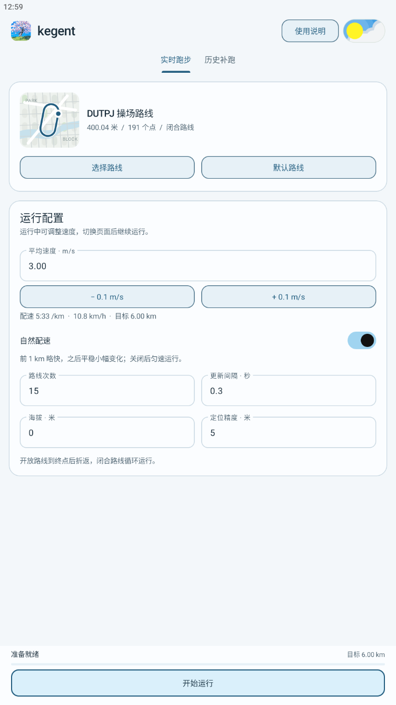
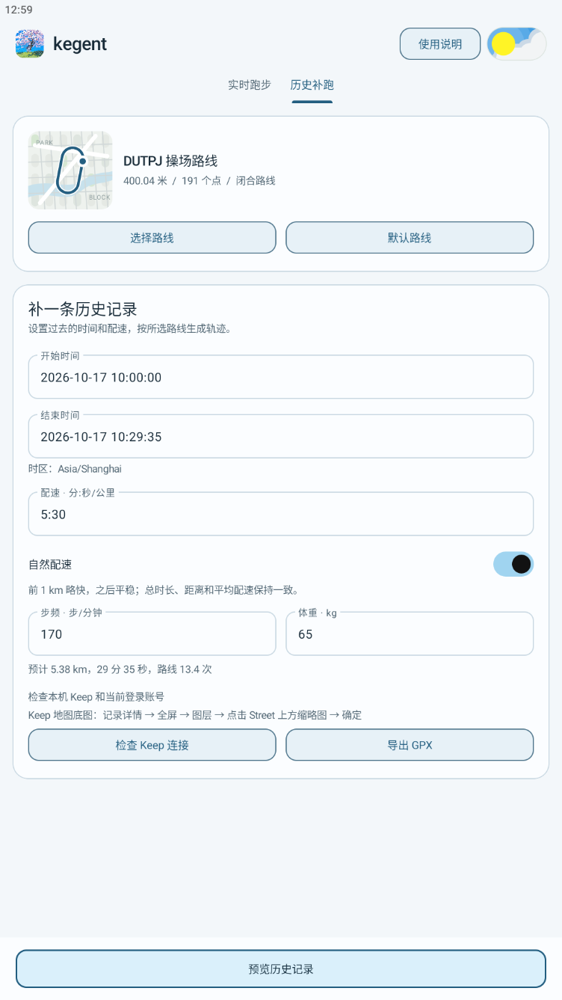
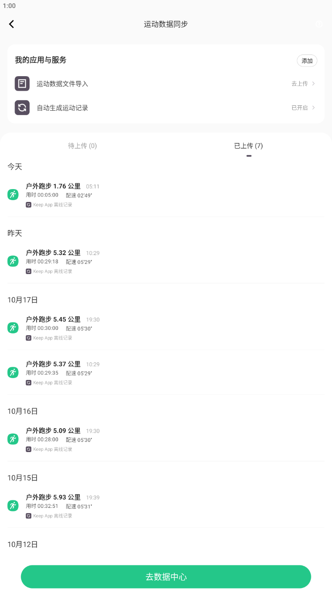

# kegent
## 免责声明：本项目仅用于逆向学习部分实现，不可用于任何形式的商业用途

kegent 是基于 [LangQi99/dlut-FakeRun](https://github.com/LangQi99/dlut-FakeRun) 魔改的 Android 路线与跑步配置工具。加入实时跑步控制、自然配速、单条历史记录生成，以及针对指定版本 Keep 的本地交接功能。

可以选择一条路线实时模拟定位，也可以按过去的起止时间和平均配速生成记录，预览后导出 GPX，或交给本机 Keep 处理同步。

| 项目 | 当前配置 |
| --- | --- |
| 应用名称 | `kegent` |
| 应用 ID / 源码包名 | `com.haven.kegent` |
| 当前版本 | `1.3.1`，调试构建为 `1.3.1-dev` |
| 系统要求 | Android 8.0 及以上（API 26） |
| 技术栈 | Java、Android Views、Material 组件、Gradle |

## 界面预览

| 实时跑步 | 历史补跑 | Keep 数据同步（已上传） |
| :---: | :---: | :---: |
|  |  |  |

第三张截图展示 Keep 的「运动数据同步 → 已上传」页面；运动历史列表的来源标识验证状态见下文「“Keep App”来源标识」。

## 功能与改动

- **路线配置**：内置约 400 米的 DUTPJ 路线，支持导入 KML。开放路线到终点后折返，闭合路线循环运行。
- **实时跑步**：配置速度、路线次数、定位更新间隔、海拔和精度；支持暂停、继续、调速、结束及通知栏控制。暂停时间不计入有效时长，调速保留当前路线进度。
- **自然配速**：默认启用。超过 1 km 的记录前段略快，随后平滑过渡；中后段结合不同尺度的连续变化，增加分段配速的起伏。关闭后使用匀速模式。
- **单条历史补跑**：按精确到秒的过去起止时间和平均配速计算距离，结合步频、体重估算步数与热量。同一条记录的预览、GPX 导出和 Keep 交接使用一致的配速曲线，保留指定的总时长、总距离与平均配速。
- **轨迹预览与导出**：按路线坐标绘制轨迹，异步加载并缓存 OpenStreetMap 底图，支持历史记录导出 GPX。
- **界面适配**：保留浅蓝视觉风格，支持浅色 / 深色主题、手机窄屏、横屏和平板布局；原生动效遵循系统动画设置。

## 开始使用

### 实时跑步

1. 安装 kegent，按提示授予定位等运行权限。
2. 在 Android「开发者选项」中，将 kegent 设为模拟定位应用。
3. 打开「实时跑步」，使用内置路线或导入标准 GPS / WGS84 坐标的 KML 文件。
4. 设置速度、路线次数等参数，确认预览后开始运行。
5. 运行中可在应用内暂停、继续、调速和结束；通知栏提供暂停 / 继续与结束操作。

实时模拟定位不要求 Root；其他应用是否接收模拟定位，取决于其自身行为和设备环境。

### 单条历史补跑(模拟器在设置中开root)

1. 打开「历史补跑」，选择路线，填写过去的开始时间、结束时间和平均配速。
2. 填写步频、体重，并按需启用「自然配速」。
3. 生成预览，核对时间、距离、配速和轨迹。
4. 选择导出 GPX；如需交给 Keep，先点击「检查 Keep 连接」，核对版本与账号，再确认「加入并打开 Keep」。
5. 交接后在 Keep 中检查同步状态和最终记录。

历史记录根据填写的参数生成，步数与热量属于估算值。当前按单条记录操作；普通未 Root 设备也可使用预览和 GPX 导出。

## Keep 接入说明

### 支持范围与同步行为

| 条件 | 要求 |
| --- | --- |
| Keep 版本 | **8.7.30 / versionCode 49337**，其他版本可能会拒绝交接 |
| 安装位置 | Android 主用户中已安装并登录的 Keep |
| 设备权限 | 已提供 Root 权限 |
| 系统命令 | 可用的 `sqlite3`、`stat`、`restorecon` |
| 运动状态 | Keep 当前没有正在记录的运动 |

交接前会检查版本、账号和本地数据结构，并备份本地索引；写入时检查重复记录及与本地待同步跑步的时间重叠。Keep 的登录认证与云端同步仍由 Keep 自身处理。

**加入 Keep 后，记录可能自动同步到云端，不一定等待手动点击上传。** 请在确认交接前核对记录。kegent 显示的交接成功只代表完成本地写入，云端是否接受、如何显示，以 Keep 的最终结果为准。

这是针对指定客户端版本的私有存储适配。Keep 升级后需要重新核对数据结构与同步行为；更新 kegent 不会自动修改已经上传的云端记录。

### “Keep App”来源标识

1.3.1 修正了来源身份的序列化格式，解决旧版来源信息被 Keep 解析为空的问题。正确字段已通过 Keep 本地解析和上传序列化验证，**修复后在云端运动历史列表中显示“Keep App”的结果仍待验证**。

- 待上传页的“Keep App 离线数据”是 Keep 客户端的固定文案。
- 上传后的运动历史列表使用服务器返回的来源名称和图标。

因此，待上传页出现该提示不能证明上传后会显示来源标识，也不能通过调整本地队列分类来修改上传后的文案。详细字段、备份位置和接入流程见 [Keep 接入文档](docs/KEEP_INTEGRATION.md)。

## 地图与路线坐标

导入 KML 应使用标准 **GPS / WGS84** 坐标。实时模拟定位和 GPX 导出保持 WGS84；交给 Keep 时，适配器按其腾讯定位链路在适用范围内转换为 GCJ-02。请勿将已经转换过的高德 / 腾讯坐标再次作为 WGS84 导入。

kegent 的预览使用 OpenStreetMap 底图并保留署名。网络或瓦片服务不可用时，页面仍显示轨迹及回退背景，回退背景不代表真实街区。Keep 使用自己的地图服务与图层，两者的样式可能不同。

如果 Keep 记录中只有轨迹、没有道路或地名，可打开记录的「全屏 → 图层」，**点击 Street 上方的地图缩略图（皮肤）**，然后确认。只点击下方的 Street 文字可能不会切换；「隐藏地图」或 Gotham 图层可能呈现纯色 / 深色背景。

## 本地构建

需要 JDK 17 或兼容的更新版本，以及 Android SDK 36。项目使用 Gradle Wrapper 8.14.3、Android Gradle Plugin 8.13.0；`compileSdk` 为 36，`targetSdk` 为 34，`minSdk` 为 26。

1. 在 Android Studio 中打开项目，或准备好命令行构建环境。
2. 在项目根目录的 `local.properties` 中配置本机 Android SDK 路径。该文件已被 Git 忽略，例如 Windows 可填写：

   ```properties
   sdk.dir=C:/Android/Sdk
   ```

3. 在项目根目录执行构建与本地检查。

**Windows PowerShell**

```powershell
.\gradlew.bat :app:exportDebugApk :app:testDebugUnitTest :app:lintDebug
```

**macOS / Linux**

```sh
chmod +x gradlew
./gradlew :app:exportDebugApk :app:testDebugUnitTest :app:lintDebug
```

生成的安装包位于：

```text
app/build/outputs/apk/kegent/kegent.apk
```


设备测试使用 `:app:connectedDebugAndroidTest`，建议在专用测试设备上运行，并提前备份应用设置：测试流程会安装、卸载目标应用和测试包。普通设备测试默认跳过实际模拟定位服务与 Keep 写入测试；Keep 写入测试需要显式启用，同时隔离 IPv4 / IPv6 网络，并在结束后清理测试记录。

## 项目文档与来源

| 文档 | 内容 |
| --- | --- |
| [Keep 接入说明](docs/KEEP_INTEGRATION.md) | 支持版本、接入流程、来源字段、备份与同步边界 |
| [验证记录](docs/VALIDATION.md) | 构建、测试、设备验证结果及未验证事项 |
| [源码恢复记录](docs/RECOVERY.md) | KmAo 资源恢复过程与可恢复范围 |
| [素材来源记录](docs/ASSET_PROVENANCE.json) | 图标、栅格素材的来源与摘要 |
| [产品约定](PRODUCT.md) | 功能范围与产品行为约束 |
| [设计约定](DESIGN.md) | 视觉风格与交互规范 |


感谢原项目 [LangQi99/dlut-FakeRun](https://github.com/LangQi99/dlut-FakeRun) 提供的路线与模拟定位实现基础。
