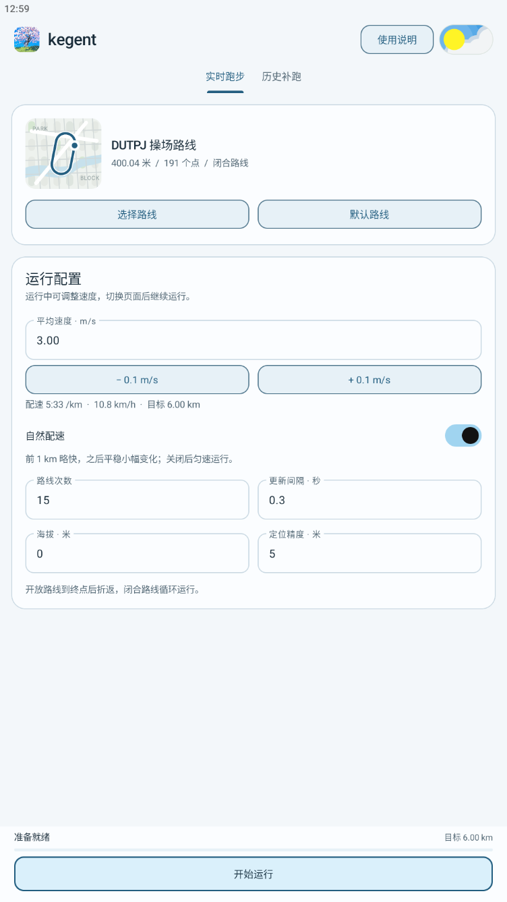
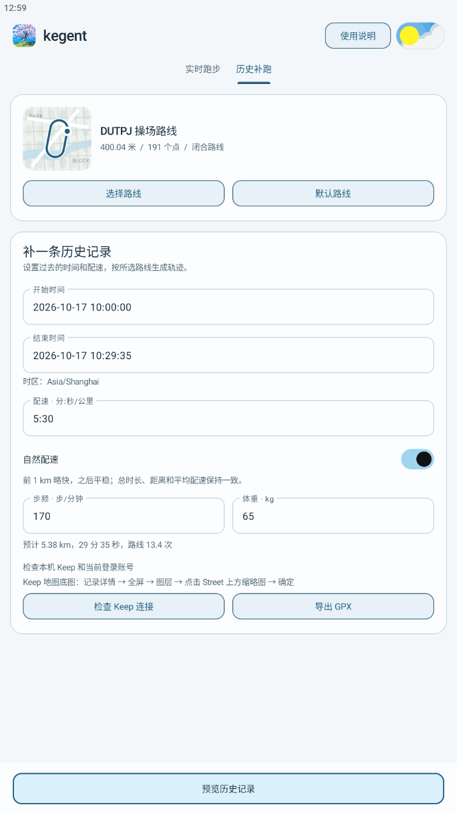
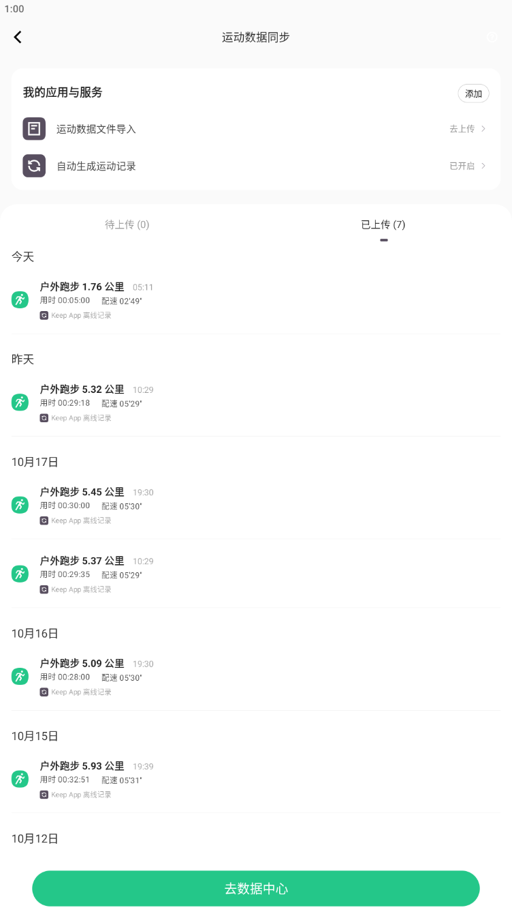

# kegent
## 免责声明：本项目仅用于逆向学习部分实现，不可用于任何形式的商业用途
## 详细教程：https://my.feishu.cn/wiki/WVlswXjAbirvtQkGJc0cpGdEnQf
## 上方飞书云文档链接若失效，可直接访问云盘中的教程https://yun.139.com/shareweb/#/w/i/2yA8uPxKJMcu0
kegent 是基于 [LangQi99/dlut-FakeRun](https://github.com/LangQi99/dlut-FakeRun) 魔改的 Android 路线与跑步配置工具。加入实时跑步控制、自然配速、单条历史记录生成，以及针对指定版本 Keep 的本地交接功能。

可以选择一条路线实时模拟定位，也可以按过去的起止时间和平均配速生成记录，预览后导出 GPX，或交给本机 Keep 处理同步。

| 项目 | 当前配置 |
| --- | --- |
| 应用名称 | `kegent` |
| 应用 ID / 源码包名 | `com.haven.kegent` |
| 当前版本 | `2.0.0`，调试构建为 `2.0.0-dev` |
| 系统要求 | Android 8.0 及以上（API 26） |
| 技术栈 | Java、Android Views、Material、MapLibre Native、Gradle |

## 界面预览

| 实时跑步 | 历史补跑 | Keep 数据同步（已上传） |
| :---: | :---: | :---: |
|  |  |  |

# 如何使用kegent补填校园跑（2\.0\.0版本）

# 程序与环境准备

## 本应用理论上适用于任意模拟器以及实现root的安卓手机，考虑到便利性与安全性，推荐使用蓝叠 5（bluestack 5）模拟器（在这之前确保您拥有windows计算机）

> 使用 蓝叠 5（bluestack 5）运行该项目的好处：只需要一台windows系统机器
> 
> 

1. 下载BlueStacks 5模拟器，可以从官方下载，或者通过下方给出的链接中的云盘下载

2. 下载kegent，可以在github release（https://github\.com/Haven\-mao/kegent/releases/tag/v1\.3\.1）中下载，也可以通过给出的云盘链接中下载

3. 下载keep apk，建议使用本人开发时使用的版本，该版本apk也在下方云盘链接中给出

    **云盘链接**

    > **（为什么使用中国移动云盘，因为其它云盘不开会员都严重限速）**
    > 
    > 

    https://yun\.139\.com/shareweb/\#/w/i/2yA8uPxKJMcu0

## 下载云盘内容到本地文件夹之后，双击蓝叠的下载器（BlueStacksMicrolnstaller\.exe）下载蓝叠本体

1. 打开后的蓝叠如下，将文件夹中从云盘中下载的apk拖入蓝叠

确保拖入蓝叠之后两个apk完成安装

2. 根据下图箭头指引完成蓝叠root与**adb开启**

# **如何进行keep运动**

## 0\. 如何在地图选出自己想要的轨迹

### **如果你是大连理工大学盘锦校区的学生**

应用内已经内置了大连理工大学盘锦校区风雨操场的轨迹，直接使用即可，如果你对轨迹不满意，也可根据说明自行创建

### 导入KML文件（不推荐，操作比较麻烦）

1. 前往google earth https://earth\.google\.com

2. 点击探索地球

3. 如下图，选择路径或多边形

4. 在地图上创建路径（下图仅为示例，实际使用请多选一些点，注意最终需要闭合曲线）

5. 点击保存到项目

6. 点击文件，导出为KML文件（如下图）

7. 进入kegent \-\> 点击当前使用的路线 \-\> 点击导入KML并保存

### 使用程序内置绘制工具进行绘制（推荐\<2\.0\.0版新功能\>）

1. 打开kegent，点击地图绘制（如下图）

2. 搜索目的地，此处以主校区为例（虽然主校区也用不上）

3. 如果是道路则选择道路进行绘制，如果是操场则找到操场选择操场（tips：按住ctrl \+ 滚轮上下可以快捷放大缩小地图）

4. 点击保存并应用 \-\> 设置路线名称 \-\> 点击保存 即可使用该路线

## 悟已往之不谏

本功能模块用于向**已经过去的时间段内导入记录**（期末保命）

1. 打开keep，使用手机验证码登录自己的账号

2. keep保持后台，打开kegent

3. 选择开始和结束时间、配速、步频等信息，未填写的信息会有算法自动补充，见图1

4. 点击预览历史记录，见图二

5. 点击检查keep连接后，点击交给keep同步

6. 点击加入并打开keep（会自动跳转到keep的上传数据页面）

7. 点击上传全部

完成以上操作之后，在手机keep上你就会发现记录已经补上去了

**tips：如果出现该情况，改个图层就可以**

## 知来者之可追

本功能模块用于**实时跑步**，操作非常简单

1. 打开keep

2. 保留keep后台，打开kegent

3. 选择参数并点击开始运行之后保留后台（由于蓝叠等模拟器部分安卓传感器通道问题，实时跑步不支持定制步频等某些信息）

4. 回到keep开始户外跑会自动定位到大盘，根据配速一般只需要等待半小时左右即可

# 免责声明

1. 本项目虽然参考了部分keep的实现，但是没有在本人程序中调用任何keep内部相关接口，所有上传操作皆由keep源程序运行，在keep的可执行操作范围内，未侵犯keep的合法权利，**本项目不支持任何商业化或盈利举动**，如果影响到了您的正当盈利或者侵犯了版权信息，请联系删除

2. 校园跑本意是促进学生课余锻炼，所以如若使用该项目，还请适量

①根据二〇〇二年一月一日《计算机软件保护条例》规定：为了学习和研究软件内含的设计思想和原理通过安装、显示、传输或者存储软件等方式使用软件的，可以不经软件著作权人许可，不向其支付报酬！

②本项目尊重各网络文件的版权问题，所有资源均出自网络，所有提供下载的资源均为资源作者提供和网络收集整理而来，仅供学习和研究使用。下载本项目的用户必须明白，本项目对提供下载的资源等不拥有任何权利，其版权归该资源的合法拥有者所有。

③本项目不承担用户因使用这些下载资源对自己和他人造成任何形式的损失或伤害。不论何种情形本项目都不对任何由于使用或无法使用本项目提供的资源所造成的直接的、间接的、附带的特殊的或余波所及的损失、灵失、债务或中断负任何责任\[不论是可预见或是不可预见的，即使本项目已被告知这种可能性\]。

④如有侵犯您的版权，请私信本项目将立即改正。本项目对互联网版权绝对支持。

⑤下载本项目资源后在7天内删除仅供学习和研究使用。

# 完结撒花

感谢您看到了本文最后

如果可以的话，**希望能给github仓库一个star～\(∠・ω\<\)⌒★，您的star是继续开源的动力**

https://github\.com/Haven\-mao/kegent

感谢原项目 [LangQi99/dlut-FakeRun](https://github.com/LangQi99/dlut-FakeRun) 提供的路线与模拟定位实现基础。
