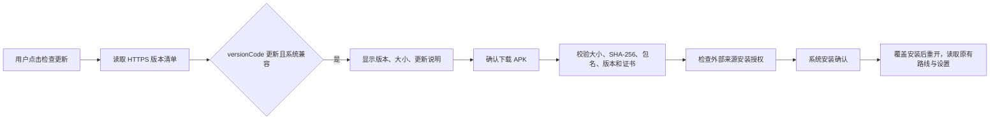

# 应用内更新可行性与接入方案

调研日期：2026-11-10。本次为调研，未接入更新模块，未新增安装权限，未更换签名或发布远程版本。

后续状态：已按用户要求在 1.4.4 接入更新模块、安装权限、产物生成脚本及发布工作流。本文保留原始调研；实际使用和发布步骤见 [应用内更新接入说明](APP_UPDATE.md)。远程 Release 与签名 Secrets 尚需按说明配置发布。

## 结论

可以实现“应用提示新版本 → 查看更新内容 → 在应用中下载 APK → 调用 Android 系统安装器覆盖更新”，正常覆盖安装保留路线库、草稿和设置。当前 GitHub 发布、自行下载安装与蓝叠使用方式适合自建 APK 更新流程。

已经安装的旧版没有更新代码，无法只靠以后发布 Release 就凭空出现更新入口。需要先让用户手动安装一次包含更新模块的版本；该版本成为以后更新的起点。

“应用内更新”不等于所有系统都静默安装。本项目 minSdk 26，当前蓝叠是 Android 9；推荐统一采用用户确认安装的流程。Android 12 及以上的 PackageInstaller 有在特定条件下无需用户操作的机制，但有安装来源、权限与目标 SDK 等前提，仍须处理需要用户操作的返回值，不能据此承诺整个支持范围静默更新。

## 已核对的项目与发布状态

| 项目 | 核对结果 | 影响 |
| --- | --- | --- |
| 包名与系统范围 | `com.haven.kegent`，minSdk 26，targetSdk 34 | 更新保持包名，处理 Android 8 起的外部来源安装授权 |
| 当前本地交付 | 本次界面调整为 `1.4.3-dev` / versionCode 10；`exportDebugApk` 导出 debug APK | 今后更新按整数 versionCode 判断，不能只比较显示版本名或 Git 标签 |
| 签名配置 | Gradle 没有 release signingConfig；现有包使用本机 `C:/Users/24407/.android/debug.keystore` | 后续发布必须固定同一签名私钥，不能让 CI 每次自动创建新 debug key |
| APK 更新代码 | 未发现版本检查、APK 下载、FileProvider 安装链路或 REQUEST_INSTALL_PACKAGES 权限 | 当前版本不能在应用中升级，需要后续新增模块 |
| CI | `.github/workflows/android.yml` 只对 main 的 push/PR 执行 `./gradlew build` | 未固定发布签名，未创建 tag Release，也未上传 APK 或版本清单 |
| GitHub 仓库 | 公开仓库 `Haven-mao/kegent` | 可以公开提供版本信息与 APK，应用无需内嵌 GitHub Token |
| 已发布 Release | 调研时 latest 为 `v1.3.1`，Release assets 数量为 0；正文链接到 user-attachments 下的 ZIP | 当前 ZIP 正文链接不适合作为稳定机器更新协议；应改为正式 APK 与清单资产 |

## 旧安装包的签名兼容性

已从官方仓库 `v1.3.1` Release 正文链接下载 ZIP，提取其中 APK，只进行签名与元数据读取，未安装它。结果：

- 已发布 APK：`com.haven.kegent`，`1.3.1-dev` / versionCode 6。
- 本地交付 APK：同包名，签名证书为 Android Debug。
- 两者证书 SHA-256 一致：`3b2756ff4b3920fac9738a20d5d2ad6900a4e5c4f774edea62a1ffc049ba8190`。
- 本机 debug.keystore 的 androiddebugkey 证书也匹配，证明本机当前保有可继续签出兼容更新包的密钥。

因此，从该已发布 APK 或本轮本机签名包安装的用户，具备相同签名覆盖更新的基础。其他人自行编译、重新签名或使用不同包名的版本不在此结论范围；新 APK 的系统兼容性、versionCode 和数据迁移仍需验证。

需要明确选择未来签名策略：短期兼容通道可固定沿用已有证书，并将同一私钥安全配置到发布环境；若要更换正式发布证书，应单独评估 Android 8 及后续系统的证书迁移，不直接换 key 后声称老用户能无损覆盖。不能只保留公钥证书，签包需要对应私钥。本次未复制、上传或更改私钥。

## 推荐架构

初期不需要新增业务后端：使用 GitHub Releases 保存 APK、更新说明和结构化清单；为用户提供固定 HTTPS 版本清单地址。下载链路在实际用户网络不稳定时，可以配置自有 HTTPS 镜像，仍保持签名校验。

建议入口放在“关于 / 检查更新”，首期提供手动检查；后续可在应用进入前台时每天最多检查一次。网络失败或用户选择稍后不影响正常功能。运行路线或正在处理记录时可下载，但延后安装，避免替换进程打断工作。

版本清单最少包含：

| 字段 | 用途 |
| --- | --- |
| schemaVersion、applicationId、channel | 清单格式、目标包名及发布通道 |
| versionCode、versionName | 单调递增比较与展示 |
| minSdk | 下载前判断设备系统兼容 |
| apkUrl、sizeBytes、sha256 | 下载完整性与来源控制 |
| releaseNotes、publishedAt | 用户查看本次变化 |

清单不写入任何签名私钥、GitHub 访问令牌或服务器凭据。APK 下载地址来自受控发布流程；安装前将 APK 的证书与本机已安装包比较，不能仅依据远端清单中的证书字符串决定可信。

## Android 实现要点

1. 增加版本检查组件，通过 HTTPS 请求清单，使用 ETag 或合理缓存；解析、超时、错误提示和取消不阻塞主线程。
2. 增加下载组件，显示进度，保留临时文件，取消/失败后可重试。首版采用完整 APK 下载，不增加差分补丁与重打包复杂度。
3. 完成后校验文件大小与 SHA-256，并用 PackageManager 读取 APK 包名、versionCode 与签名，拒绝错误包名、版本不递增、证书不兼容的包。Android 8 与 9 以上的签名读取 API 需要分支处理。
4. 声明 `REQUEST_INSTALL_PACKAGES`，使用 `canRequestPackageInstalls()` 检查信任，必要时打开 `ACTION_MANAGE_UNKNOWN_APP_SOURCES`。从设置页返回后重新检查，并允许用户取消。
5. 通过仅暴露更新 APK 目录的 FileProvider 生成 `content://` URI、授予临时读取权限，调用系统安装器；或使用 PackageInstaller Session。不要使用宽泛文件路径配置。
6. 安装取消或失败时保留旧应用可用，安装成功通过新版实际启动与本地 versionCode 确认，不把“下载成功 / 打开安装器”当作更新完成。
7. 新旧版本保持数据兼容；测试路线库、当前选择、草稿和参数升级后均可读取，不卸载重装，不清空应用数据。

## 后续发布流水线

1. 发布代码使用明确版本和递增的 versionCode，先完成构建、单测、Lint。
2. tag 触发受控发布任务，注入固定签名密钥，生成签名 APK；用 apksigner 核验证书与预期固定指纹一致。
3. 从实际产物提取包名、版本、最低系统和大小，计算 SHA-256，自动生成清单，避免手工填写错包或错版本。
4. 先上传 APK、清单和说明为正式 Release assets，确认可下载后再更新稳定清单入口；用户下载的旧清单仍指向存在的 APK。
5. 不把每次开发分支或 main 的普通构建作为正式更新，不给 beta/prerelease 自动覆盖稳定用户。
6. 私钥和口令只放在受控签名环境/CI Secrets，仓库不提交 keystore。公开仓库的 Pull Request 检查不应拿到发布签名权限。

现有 Release 资产需要重整才能实现上述流程。本次没有创建新 Release，也没有更改 GitHub Actions。

## 工时与验证

基础检查更新、下载、校验、系统安装与发布清单接入，预计单人约 3–5 人日；签名策略确认、用户网络与机型适配另计。单独的路线列表 UI 调整不依赖更新模块。

后续实施必须验证：

- 从已发布 1.3.1 以及当前 1.4.x 兼容签名包覆盖升级，路线库与设置保留。
- 已装旧版先手动装一次更新入口版本，再验证后续完整应用内更新链路。
- 错误签名/包名/摘要、版本回退、系统不兼容、下载中断、磁盘空间不足均不进入成功状态。
- Android 8/9 安装授权、用户拒绝与取消；更新后重新打开显示真实安装版本。
- 发布清单和 APK 相互一致，GitHub 或镜像在实际用户网络可达。

## 官方资料与核对入口

- [Android 应用签名与升级证书](https://developer.android.com/studio/publish/app-signing)
- [Android 版本管理](https://developer.android.com/studio/publish/versioning)
- [Google Play 应用内更新](https://developer.android.com/guide/playcore/in-app-updates)：适合通过 Play 分发并满足其使用前提的通道，不是当前 ZIP/APK 分发的直接替代。
- [Google Play 更新测试条件](https://developer.android.com/guide/playcore/in-app-updates/test)
- [canRequestPackageInstalls](https://developer.android.com/reference/android/content/pm/PackageManager#canRequestPackageInstalls())
- [外部来源安装设置](https://developer.android.com/reference/android/provider/Settings#ACTION_MANAGE_UNKNOWN_APP_SOURCES)
- [PackageInstaller 用户操作要求](https://developer.android.com/reference/android/content/pm/PackageInstaller.SessionParams#setRequireUserAction(int))
- [FileProvider](https://developer.android.com/reference/androidx/core/content/FileProvider)
- [GitHub Release API](https://docs.github.com/en/rest/releases/releases#get-the-latest-release)
- [当前仓库 Release](https://github.com/Haven-mao/kegent/releases/tag/v1.3.1)

上述远程状态和官方文档于调研日期读取；未来发布状态、系统限制和服务可用性变化时应重新核对。
