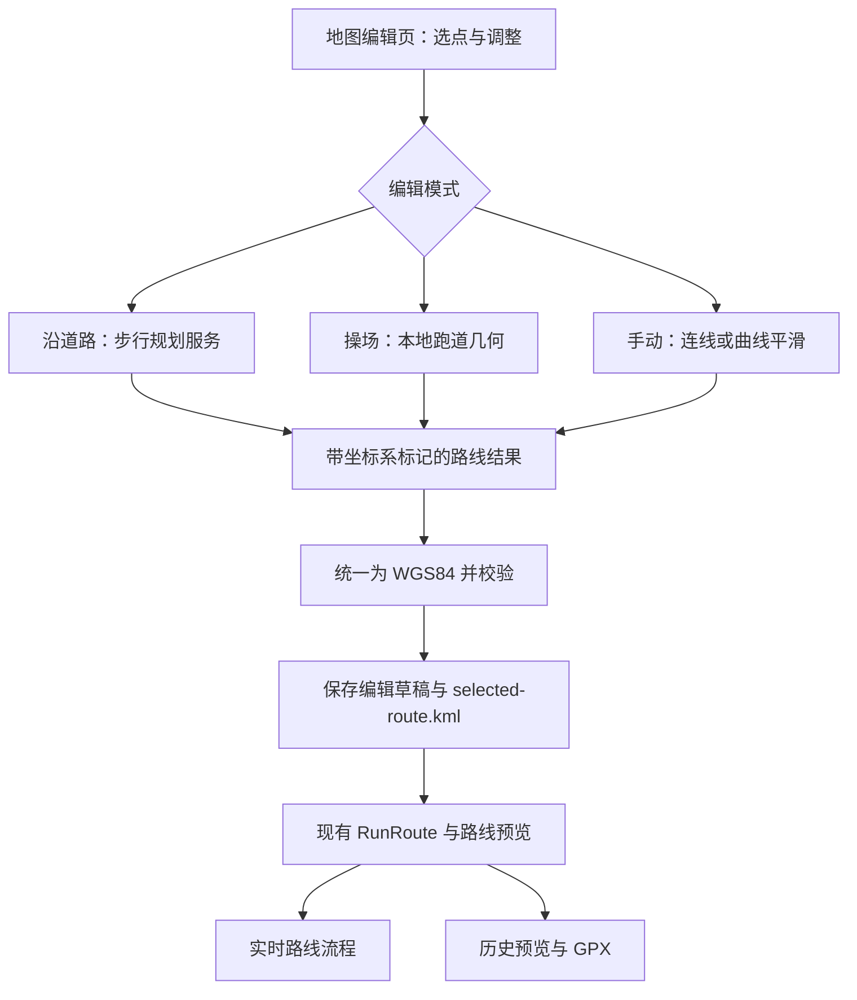

# 内置地图选点与轨迹拟合方案

评估日期：2026-11-10。源码基线：本地 `main`，`85315d5`，应用版本 `1.3.1`。本文为源码与官方文档评估，尚未进行地图 SDK、路线服务或设备接入验证。

后续状态：已按用户要求实施 1.4.0。本文保留原始评估；实际接入、默认测试服务、文件格式及验证范围见 [地图编辑接入说明](MAP_ROUTE_EDITOR.md)。

## 1. 结论与范围

技术上可行，现有路线模型可以直接承接地图编辑结果。建议新增独立的原生全屏路线编辑页，提供两个主要模式：

- **沿道路规划**：依次选择起点、途经点、终点，按步行路网生成完整路线，支持逐段修改。
- **操场模式**：在地图上放置、旋转和调整跑道模板，本地生成闭合曲线，支持起跑点与方向设置。

两种模式共用选点、撤销、预览、保存等能力；另提供手动连线和可选曲线平滑，用于路网未收录的小径、非标准操场。

本需求不需要训练模型或接入大模型。“自动拟合”由路线规划服务和确定性几何算法分别完成。自动识别卫星影像中的跑道不属于本期方案；模板由用户放置并校准。

## 2. 项目现状与可复用部分

| 已核对的源码 | 当前行为 | 对接意义 |
| --- | --- | --- |
| `app/build.gradle.kts` | Java / Android Views / Material；minSdk 26、targetSdk 34、compileSdk 36；尚无地图 SDK 依赖 | 可以增加原生 MapView，具体 SDK 版本、ABI 和构建兼容性需要原型验证 |
| `ui/RoutePreviewView.java` | 自绘 Canvas，按已有路线计算视野，加载并缓存 OSM 栅格瓦片；没有地图平移、缩放或选点手势 | 已有地理预览基础，但不是可直接开启编辑的完整地图组件 |
| `FakeGPSActivity.java:229` | “选择路线”直接打开 KML 文件选择器 | 可以新增“地图绘制”入口，保留 KML 入口 |
| `core/RunRoute.java:37` | 接收坐标数组，去除相邻重复点，计算累计距离；最多 50,000 点 | 编辑器输出可以直接构造相同路线对象 |
| `core/RunRoute.java:53` | 首尾距离小于 0.5 米视为闭合 | 操场保存时应显式将首点复制为末点 |
| `core/RunRoute.java:138` | 开放路线到终点后折返，闭合路线循环；按累计距离插值取点 | 道路与操场均可复用，但界面必须说明开放路线的折返行为 |
| `FakeGPSActivity.java:598`、`LocationMockService.java:90` | 页面和后台服务分别从 `selected-route.kml` 读取路线 | 不能只更新界面中的 RunRoute；必须保存并统一读取同一份路线 |
| `FakeGPSActivity.java:624` | `useRoute()` 更新预览并使已有历史预览失效 | 新路线保存后可以沿用这一入口 |
| `FakeGPSActivity.java:1107` | GPX 按路线距离取得坐标；项目约定输入、内部路线和 GPX 均为 WGS84 | 坐标体系需要在地图适配层隔离 |
| `keep/KeepCoordinates.java` | 当前仅实现 WGS84 到 Keep 使用的 GCJ-02 坐标转换 | 若选国内 GCJ-02 地图，现有工具不足以直接把选点转换回内部坐标 |

源码中的现有插值只是在折线段上按距离取位置，既不是道路规划，也不是曲线拟合。现有“离线街区风格底图”是装饰背景，不能作为真实离线地图用于选路。

## 3. 地图与路线服务选型

需要分别决定**地图渲染组件、底图服务、路线规划服务**。地图 SDK 自身不会自动提供全部路网能力。

| 方案 | 适配情况 | 成本与约束 | 建议 |
| --- | --- | --- | --- |
| MapLibre Native + 合规 OSM 衍生底图 + Valhalla 步行服务 | 原生 Android；路线可统一使用 WGS84；与现有 OSM 预览方向一致 | 需要配置底图及路线服务；国内目标区域覆盖、网络和蓝叠图形兼容性待验证 | **默认推荐**，适合继续保存、编辑和导出路线 |
| 高德原生地图 + 搜索 SDK 步行规划 | 提供地图交互及步行路线结果；需要 Android Key、包名和签名 SHA1 | 使用 GCJ-02；需核对路线数据保存、导出及脱离服务使用的授权，另核对账号配额及许可 | 作为国内地图优先需求下的备选，数据使用条件确认后采用 |
| 本地 Leaflet 页面 + Android WebView + 路线服务 | 可以在应用内平移、缩放、点选，适合快速原型 | 要维护 Java/JS 桥接、资源加载、生命周期、缓存和触摸冲突；仍然需要底图与路线服务 | 原型或原生渲染兼容性不佳时的备选 |
| 在现有 RoutePreviewView 中自行实现完整地图 | 不增加第三方地图组件 | 需要自行实现相机、逆投影、多点触摸、拖拽命中、瓦片调度与缓存控制 | 不作为主方案，开发与维护工作明显增加 |

默认推荐 MapLibre，是因为本项目需要持久保存及 GPX 导出路线，且内部已统一 WGS84；这不代表 OSM 在目标城市的路网已经验证优于其他服务。

Valhalla 是路线引擎，不是随 SDK 附送的稳定免费接口。首期可以选择允许所需存储和导出用途的托管服务；需要控制覆盖和数据时，再部署目标地区路网。GraphHopper 的 `foot` 配置可作为替代。公共演示接口不作为正式运行依赖。

不要把高德结果默认写入当前 KML、在 OSM 预览显示并导出 GPX。其现行服务协议 3.5、4.12.4 等涉及数据存储与脱离服务使用，具体用途应按获得的许可核对。购买调用配额也不等于已经取得上述用途的许可。

OSM 公共栅格服务器没有 SLA，禁止批量抓取和预下载，要求署名、可识别的 User-Agent 和合理缓存。正式方案应将瓦片地址配置化，并使用适合实际用户量和网络环境的底图服务；MapLibre 官方演示底图也只用于原型。

## 4. 沿道路规划模式

### 用户操作

1. 进入“地图绘制 → 沿道路”，默认定位到当前所选路线附近；可移动地图或搜索地点。
2. 点击地图依次添加编号点，两个点起生成步行路线。
3. 拖动点调整位置，在已有线段中插入途经点，支持删除、撤销和重做。
4. 查看路线长度、起终点及规划状态；需要环线时开启“闭合路线”，再计算终点回到起点的道路段。
5. 保存并应用路线，返回现有参数页面。

地点搜索是独立服务能力；首期至少支持地图移动和回到当前路线，搜索能力可随选定服务接入。“定位到我”仅在用户使用时申请定位权限，地图点选本身不应强依赖实际定位。

### 自动规划的实现

- 按用户给定顺序规划，不自动重排途经点。N 个点对应 N−1 个相邻路段；闭合时增加最后一个点到起点的路段。
- 使用步行或 pedestrian/foot 模式，采用服务返回的完整几何折线，不能只连接导航转向点。步行结果是几何路径，运行速度与时间继续由现有参数决定。
- 默认按路段缓存与更新。新增末点只计算新增段；拖动中间点通常只重算相邻两段。支持多途经点的服务也可整条规划，但编辑时应避免重复请求全部线路。
- 高德当前公开的 Android `WalkRouteQuery` 指南只列出起终点及模式，不应套用驾车接口的途经点能力；多点步行按相邻点分段处理。
- 请求在后台执行；拖动结束或短暂防抖后发起。用草稿版本号丢弃过时响应，取消无用请求，限制并发和请求频率。
- 保留用户原始锚点与服务吸附后的点，显示过大的吸附距离。相邻路段端点有明显间隙时标记待修正，不能自动补一段跨障碍的直线。
- 未知路段、超时、无路线或额度不足时保留编辑草稿，标记失败路段，提供重试或显式切换手动段。
- 闭合必须规划真实回程，不能简单将首尾用直线相连。起终点相同而没有中间点时，也不能要求服务自动猜测一条环线。

道路结果不默认做自由样条平滑，因为平滑可能切过路口内侧或建筑。曲线平滑主要用于用户手动段；必要的点压缩应保留转弯形状，显示折线与用于计算距离的折线保持一致。

首版建议最多 20 个编辑锚点，作为交互和调用成本控制参数；这与最终路线的 50,000 个采样点上限是不同概念。

## 5. 操场模式

### 推荐交互

1. 点击操场中心，放置一个 400 米形状模板。
2. 拖动整体位置和旋转手柄，使模板朝向与操场一致。
3. 调整直道长度、弯道半径或宽度手柄，贴合用户希望经过的跑道中心线。
4. 设置起跑点、顺时针/逆时针、跑道偏移，查看一圈的计算长度。
5. 保存一圈几何，圈数沿用现有参数，无需将同一圈坐标复制多次。

底图具备影像图层时可以辅助校准，但影像图层和内容授权取决于底图服务。无需假设所有提供商都有可用卫星影像。

### 几何算法

标准形状采用**两条平行直线 + 两个半圆**，而非椭圆，也不调用道路规划将跑道吸附到外侧道路。

在操场附近建立以米为单位的局部坐标系，设一段直道长 S、轨迹中心线弯道半径 R，则解析周长为：

```text
单圈长度 = 2S + 2πR
```

400 米模板可以使用 `R = 36.8 m`，`S = (400 − 2πR) / 2 ≈ 84.3894 m`，这里 R 是生成轨迹的中心线半径，不是操场内沿半径。参数只是几何模板，不构成现场跑道已经实测为 400 米的结论。

- 在局部米制平面生成曲线，旋转、平移后转换回 WGS84；不能直接把经纬度当等距平面计算半径。
- 直道与弯道连接处保持切线连续，按弧长约 2 米采样并保留连接点，最后追加与首点完全相同的坐标。
- 以现有 `RunRoute.lengthMeters` 复算离散路线长度，避免只显示解析周长而输出另一种长度。
- 起跑点按单圈弧长偏移，方向通过改变点序实现；起终点位置与方向变化不能破坏闭合。
- 如提供跑道偏移，使用可编辑的实际宽度。理想形状中半径增加 w 后，单圈约增加 `2πw`；不能把所有道次都标成 400 米。
- “按地图尺寸校准”和“指定单圈长度”需要明确区分。现场形状与目标长度冲突时显示实际计算结果，由用户调整，不能暗中缩放后仍声称贴合现场。

非标准操场可切换手动闭合模式，放置若干控制点并使用向心 Catmull–Rom 等插值生成曲线，保留控制点并限制过冲，提示自交或不合理急弯。自动识别跑道边界和有噪声 GPS 轨迹的地图匹配，分别属于图像识别与 map matching，后续另行评估。

## 6. 集成结构与数据保存



建议的模块边界：

| 拟新增模块 | 职责 |
| --- | --- |
| `RouteEditorActivity` | 独立全屏 MapView；选点、拖拽、撤销、模式切换与保存 |
| `RouteDraft` | 锚点 ID/顺序、每段模式、操场参数、起点/方向、修订号、结果来源和坐标系 |
| `RoutePlanner` | 统一步行规划接口；具体服务实现与界面解耦 |
| `TrackRouteGenerator` | 本地跑道几何与采样，尽量使用纯 Java 便于验证 |
| `RouteCoordinates` | 明确地图坐标与内部 WGS84 的边界，禁止重复转换 |
| `RouteRepository` | 草稿与 KML 读写、版本关联、校验、统一加载及保存失败恢复 |

首期保留现有 `selected-route.kml` 作为应用当前路线的兼容文件，新增 JSON 保存可编辑草稿。KML 单独不能还原操场参数或原始道路锚点，所以不能只保存最终采样点。草稿与结果用相同 ID/版本关联，先暂存、校验，再发布当前版本；失败保留上一条可用路线。

若采用仍使用 GCJ-02 的地图方案，需要增加明确的输入转换路径；当前 `KeepCoordinates.fromGps()` 只有正向转换，不能对选点再次调用它来获得 WGS84。其现有转换实现也不代表已经获得第三方数据导出许可。

道路服务坐标的 `lon,lat`、Android 点对象的 `latitude,longitude` 和 KML 顺序必须分别处理。使用 WGS84 数据配合 Web Mercator 底图时，投影本身不等于转换到 GCJ-02。

地图保存后由 `useRoute()` 刷新界面、距离及历史预览。后台服务必须加载同一版本的保存结果。运行或暂停期间禁止应用另一条路线，延续当前路线选择按钮的锁定行为；退出编辑页不应覆盖当前路线。

MapView 需要接入 Activity 的生命周期、内存回收与状态恢复。界面沿用浅蓝品牌色、深色模式和横屏布局；手机用全屏地图加底部操作栏，蓝叠横屏可将参数面板放在右侧。

## 7. 分期与工作量

按熟悉现有 Java 项目的单人开发估算，完整首版约 **8–12 人日**；账号许可确认、购买服务和额外自建路线服务器的时间另计。

| 阶段 | 交付内容 | 估算 |
| --- | --- | --- |
| 技术原型 | 蓝叠/手机原生渲染、目标区域底图、数条步行规划、坐标往返及路线保存用途核对 | 1–2 人日 |
| 地图编辑与道路模式 | 独立页面、点选/拖拽、编号、撤销、分段步行规划及失败状态 | 3–4 人日 |
| 操场与手动模式 | 跑道模板、参数校准、起跑点与方向、手动段及可选平滑 | 2–3 人日 |
| 持久化与回归 | 草稿恢复、KML 对接、现有流程一致性、设备与异常场景验证 | 2–3 人日 |

建议先完成原型阶段，用实际常用区域的 5–10 条路线验证 OSM 路网和网络；同时验证蓝叠当前 ABI、图形后端及 MapView 生命周期，再锁定 SDK 版本和服务提供商。源码兼容并不等于已经确认在现有模拟器可正常渲染。

地图渲染组件开源不代表底图和路线请求永久免费。费用取决于地图加载量、锚点操作产生的规划调用量和服务条款；现阶段没有账号、用户量与服务报价，不给出固定金额。首期一般不需要新增业务后端；若选择托管 REST 服务，可按其要求增加轻量代理来保护密钥和控制配额。自建 Valhalla 则需要单独维护地区路网、数据更新与服务监控。

## 8. 实施时的验收重点

以下是后续实施的验收要求，不是本次已经通过的测试：

- 道路选点保持指定顺序；改动中间点后显示最新规划结果，旧异步响应不能覆盖新草稿；未规划段不会伪装成道路路线。
- 验证多路段衔接、过大吸附、跨河/立交附近、无路网区域和无可用步行路线；地图上的道路可见不等于路线服务能够通行。
- 400 米模板在不同位置、朝向、起跑点和方向下保持闭合；以最终 `RunRoute` 计长，目标误差不大于 0.5 米；此为软件几何验收目标，非现场测量精度承诺。
- 保存并重启后，地图预览、后台路线流程与 GPX 使用同一条几何和坐标系；切换路线后原历史预览失效。
- 环线跨首尾时位置连续；开放道路路线按当前规则折返，不出现终点跳回起点。
- KML 继续满足当前 4 MB 文件与 50,000 点限制；坐标、短路线、重复点和异常数据均在保存前校验。
- 断网、超时、服务拒绝、权限未授予、返回中断和进程重建时保留有效草稿与上一条路线；装饰回退背景明确标记，不能冒充可选点的真实街区。
- 蓝叠横屏、手机竖屏、深色模式和大字体下可操作；“地图选择坐标”可在未授权实际定位时使用。
- 实施完成后执行项目的 `:app:exportDebugApk :app:testDebugUnitTest :app:lintDebug`，并补充针对几何、坐标、持久化与异步状态的必要验证。设备验证以地图编辑、路线加载和 GPX 为本需求验收范围。

## 9. 参考依据

本地判断来自上文所列源码。外部能力和条款于 2026-11-10 核对以下官方页面；文档示例版本不作为本项目已经验证可用的版本：

- [MapLibre Native Android 源码说明](https://github.com/maplibre/maplibre-native/blob/main/platform/android/README.md)
- [MapLibre Android 入门与 MapView 生命周期](https://maplibre.org/maplibre-native/android/examples/getting-started/)
- [Valhalla 路线 API：有序途经点、costing 及 pedestrian 参数](https://valhalla.github.io/valhalla/api/route/api-reference/)
- [GraphHopper 路线配置示例：foot profile](https://github.com/graphhopper/graphhopper/blob/master/config-example.yml)
- [高德 Android 步行路线规划](https://lbs.amap.com/api/android-sdk/guide/route-plan/walk)
- [高德 Android Key、包名和 SHA1](https://lbs.amap.com/api/android-sdk/guide/create-project/get-key)
- [高德坐标转换](https://lbs.amap.com/api/android-sdk/guide/computing-equipment/coordinate)
- [高德地图 SDK 概述与服务许可说明](https://lbs.amap.com/api/android-sdk/summary)
- [高德开放平台服务协议](https://lbs.amap.com/home/terms/)
- [OSM 公共瓦片使用政策](https://operations.osmfoundation.org/policies/tiles/)
